# HD2 Dress: real cloth for your armour (guide for authors)

HD2 Dress gives skirts, capes, coat tails, sleeves, hair and ribbons the game's **own cloth physics**: the same engine
system that moves the capes. The cloth swings, drapes, settles and is pushed aside by the legs.

- **Players need nothing extra.** No script loader, no game addon: they install your mod's patch files like any other
  armour mod.
- **You stay in Blender.** Mark which part of your mesh is cloth, press Check, Fix all and Build in the HD2 Dress panel.
  The panel writes the cloth files for you.

Every picture in this guide is from a real run of the panel (the B-01 hip armour with a test skirt).

---

## 1. Install

1. **Blender 4.0 to 5.2** with **HD2SDK Community Edition** installed and enabled (the add-on every HD2 armour modder
   uses). Tested with **HD2SDK 3.11.0**; the panel warns if yours is a different version.
2. **Install HD2 Dress:** *Edit > Preferences > Add-ons*, then *Install from Disk...* in the small arrow menu at the top
   right (Blender 4.2 and newer) or the *Install...* button (Blender 4.0 / 4.1). Pick `HD2-Dress-Blender-<version>.zip`
   and tick **HD2 Dress**.
3. In the 3D view press **N** (opens the sidebar) and click the **HD2 Dress** tab.
4. The game is found by itself (HD2SDK's game folder or Steam's libraries). If the panel says *Helldivers 2 not found*,
   choose the game's `data` folder in the box it shows (`...\steamapps\common\Helldivers 2\data`).

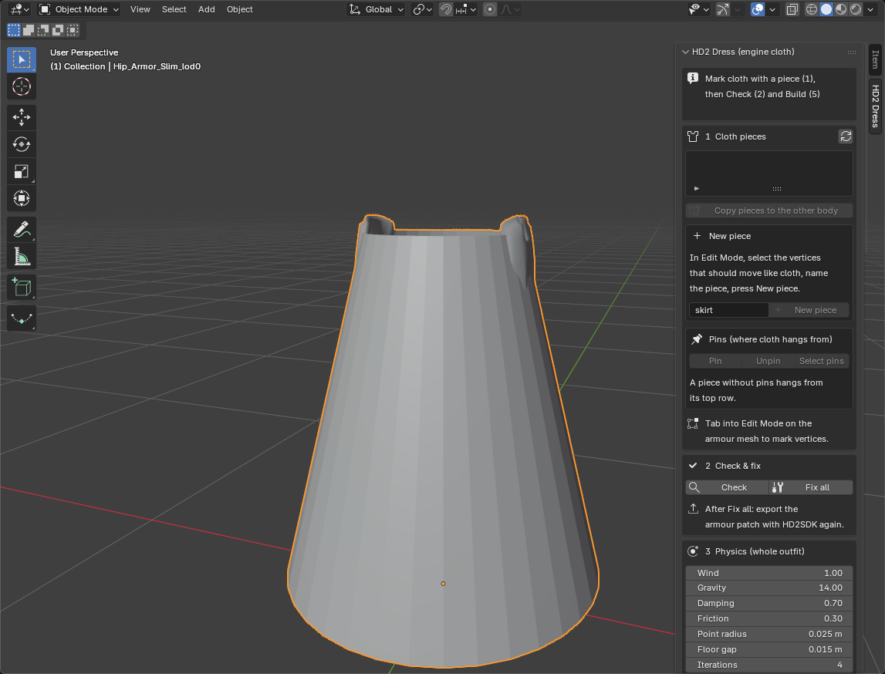

The **status box** at the top always says what just happened.

---

## 2. Before you start: your mesh

Make your armour in HD2SDK exactly as you always do, then check these six points for the cloth part:

1. **One layer.** No back faces, no Solidify: two walls a few mm apart become two separate cloths that drift apart
   and show through each other. The **colour map look draws the outside only**: if the inside can be seen (a half
   skirt seen from the front, a cape from behind), press **4 Look > Add back side**. It adds an exact reversed copy
   that moves with the front, so it cannot drift or flicker. (The cape-shader look already draws both sides: no back
   side there, two layers would flicker.)
2. **Unwrapped.** Normal continuous UVs, like any textured mesh.
3. **Faces point outward** (Fix all can flip them).
4. **Its own material.** The cloth faces need one material that no armour faces use, because the build turns that
   material into a cloth material. Armour faces on it would get the cloth look too, and cloth faces on another material
   would be invisible in game. Check tells you if this is wrong.
   **Hiding armour parts with a blank or unnamed material is fine, but not for the cloth.** Faces without a numbered
   HD2SDK material fall back to HD2SDK's default material; keep your hidden parts on that (or on your blank material),
   and give the cloth faces their own numbered material. If the cloth sits on the blank or unnamed material, the build
   stops with "no material section of the mesh holds the cloth triangles" (or "material None" before 0.6.3).
5. **The cloth on a unit of its own, with one material.** In game, a mesh that carries cloth is drawn with **one**
   material: its first. If the cloth shares a mesh with body or armour faces on other materials, those faces (or the
   cloth) show the wrong texture. Put the cloth on its own unit (an unused piece of the armour set works, for example an
   empty Accessory unit), give it one material, and Check stops complaining.
6. **Lower LODs** (lod1, lod2...) must **not** use the cloth material. Give them a normal armour material, or export
   without auto LODs.

**Blender basics used below:** **Tab** switches Edit Mode on and off. **L** with the mouse over a part selects that
whole connected part. **Alt+A** deselects everything. **Numpad 1** is the front view. **Alt+Z** is X-ray (lets a box
select vertices at the back too). **Shift+H** hides everything not selected, **Alt+H** shows it again. **Ctrl+Z** undoes
anything the panel did.

---

## 3. Step by step

### Step 1: mark the cloth (1 Cloth pieces)

Select your armour mesh, press **Tab** for Edit Mode, and select the vertices that should move like cloth. A separate
part (a skirt, a cape) is easiest: hover over it and press **L**. Type a name (`skirt`, `cape`, `hair`...) and press
**New piece**.

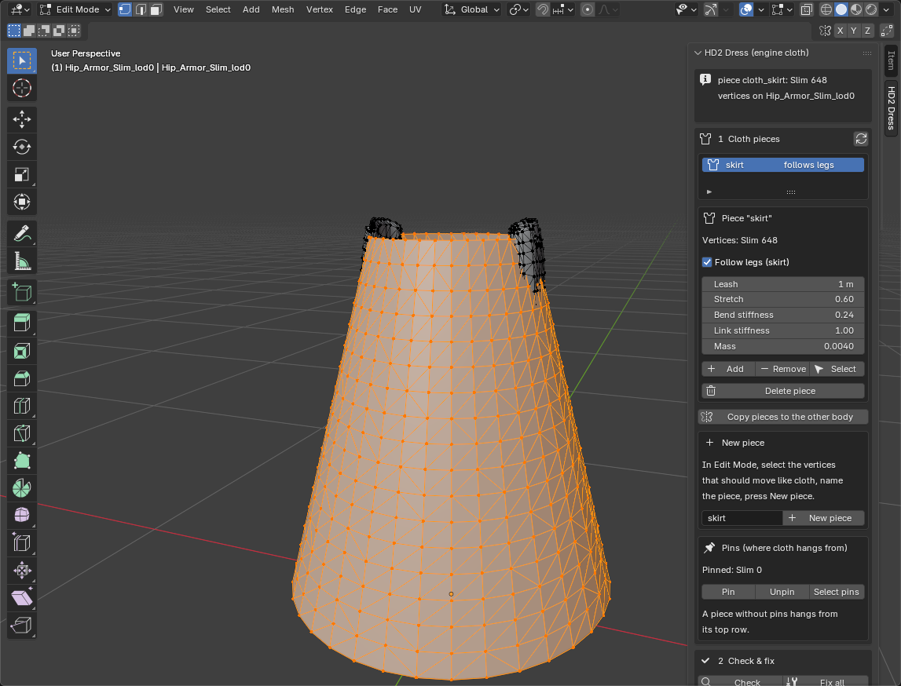

Each piece is a vertex group named `cloth_<name>` and gets its own sliders. **Follow legs** is switched on by itself for
names like skirt, dress, robe or kilt: the lower part then follows the thigh on its side, so a raised knee lifts the
fabric instead of going through it. Switch it off for capes, hair, sleeves and ribbons.

**Add / Remove / Select** change or show the piece's vertices. **Delete piece** removes only the vertex group (your mesh
is not changed) and asks first.

### Step 2: pins (where the cloth hangs from)

Pinned vertices stay on the body; everything else hangs from them. **A piece without pins hangs from its top row**,
which is right for most skirts and capes. Pin by hand when the cloth hangs from somewhere else (a sleeve from the
shoulder, a tail from its root) or to pin a whole waistband.

HD2 meshes are all triangles, so Blender's edge-loop select (Alt+click) stops after a vertex or two. Do this instead:

1. Press the piece's **Select** button, then **Shift+H** (only the piece stays visible).
2. **Numpad 1** (front view) and **Alt+Z** (X-ray), then drag a thin box across the row to pin.
3. Press **Pin**, then **Alt+H** and **Alt+Z** to get everything back.

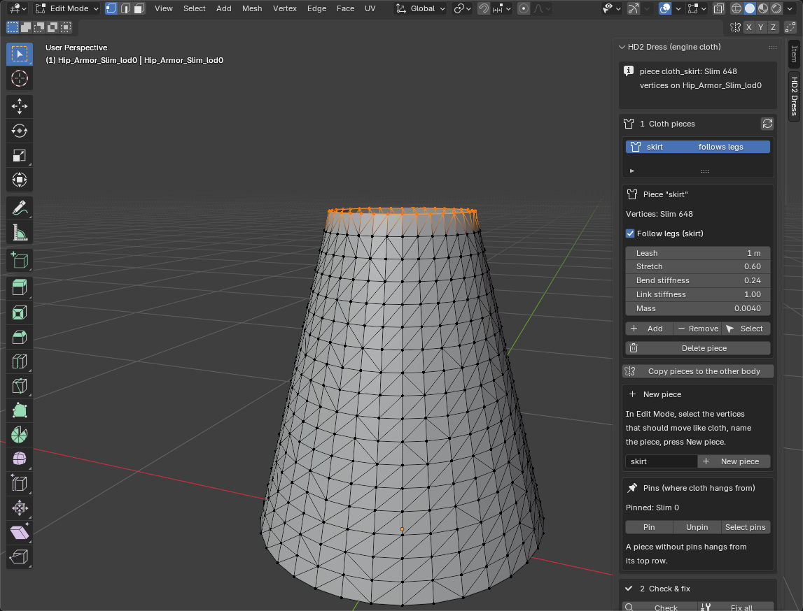

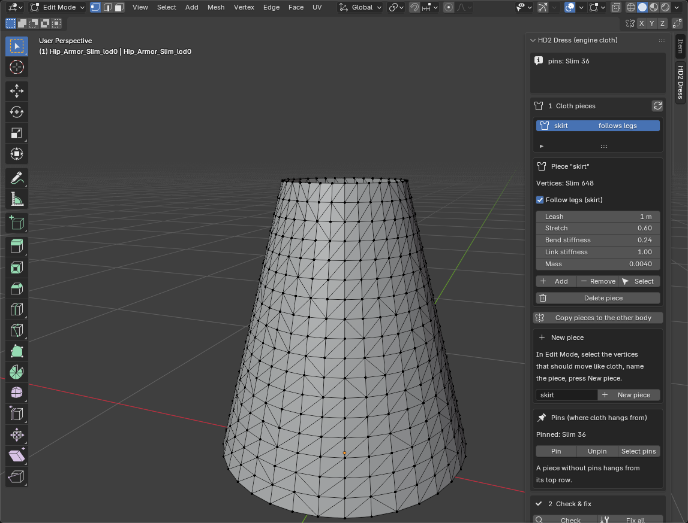

### Step 3: the other body type

Armour pieces have a **Slim** and a **Stocky** mesh, and both need the cloth. Mark one body, then press
**Copy pieces to the other body**: every piece and the pins are copied vertex by vertex. Look the copy over:
very different shapes may need a touch-up with Add / Remove.

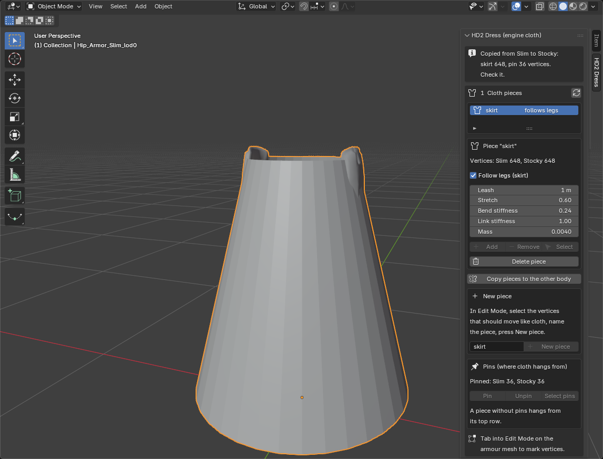

### Step 4: Check & fix

Press **Check**. Every line is one finding:

- a wrench icon = **Fix all** can do it for you (missing collision bones, UV sets, the root weight, faces turned inward,
  a mesh on a moved node),
- a question mark = a warning to read (for example armour faces sharing the cloth material, or a body without cloth),
- a red sign = you must fix it by hand,
- a tick = that body is fine.

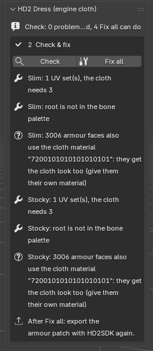

Press **Fix all** (undo-able), then **export your armour patch with HD2SDK again**, because Fix all changed the mesh
(bones, UV sets, a tiny root weight).

**Moved node.** Many armours (for example RS-100) keep a mesh on its own node away from the origin; HD2SDK shows it as
the object sitting at that spot. The game draws cloth through that node but runs its physics without it, so the cloth
would hang that far off the body. Fix all moves the node to the origin and shifts the mesh by the same amount: the
armour looks exactly the same in game. Keep HD2SDK's patch open while you press Fix all, and export right after. If you
reopen Blender before exporting, press Check again: it shows the node again and Fix all finishes the job.

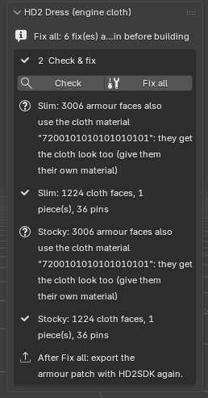

### Step 5: physics

Each piece has its own sliders (Step 1), and **3 Physics** holds the values for the whole outfit. The starting values
are the ones tested in game on a floor-length skirt; change one at a time.

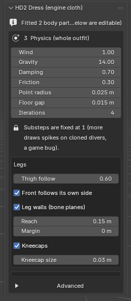

| Slider | What it does | Tested |
|---|---|---|
| Leash (piece) | how far a point may move from where it normally hangs | 1.0; 0.40-0.45 let a kneeling knee through, 0.55+ holds |
| Stretch (piece) | how much longer than at rest a point may get from its pins | 0.6 (= 1.6x) |
| Bend stiffness (piece) | resistance to folding | 0.24 drapes; 0.8 (the cape) made a skirt stand out like a cone |
| Link stiffness (piece) | neighbour links | keep 1.0: 0.7 opened gaps a knee slipped through |
| Mass (piece) | per cloth point | 0.004 (the cape: 0.003); for weight use Gravity, for wind use Wind |
| Wind | how strongly the game's wind blows this cloth (the Super Destroyer has a constant breeze; calm planets have none). Works automatically whatever you pin. Scaled to your cloth's real weight like the cape, so 1 means the same breeze on a small strip or a big cloak | 1 = like the stock cape; 0 = off; 2 = strips whip around |
| Gravity | this cloth only; stronger reads heavier (falls faster, less floaty) | 14 (9.81 = normal) |
| Damping | air drag | 0.7 |
| Friction | against the body | 0.3; 0.8 carried a skirt up the leg in a kneel |
| Point radius | collision ball around each point | 0.025; 0.02 left a hole at the knee, 0.03 floats off the legs |
| Floor gap | gap kept off the floor | 0.015 (the cape uses 0.07) |
| Iterations | solver passes per frame | 4 holds a raised knee |
| Thigh follow | Follow-legs pieces: how much of the hem follows the thigh | 0.6 |
| Leg walls | invisible walls on the legs (what the stock cape uses against clipping) | on, reach 0.15 |
| Kneecaps | an extra capsule on each knee, so collision matches a kneepad | on, 0.03 |
| Body fit | the cloth collides with invisible shapes around the **standard Helldiver**, not your mesh. Pick a body part (hips, lower back, thighs, knees and shins, feet, head, shoulders, upper arms, forearms, hands, chest) and fit it to your model. **Fit to my model** does this for you: it measures your body meshes (every HD2SDK mesh of that body type in the scene) around each collider and fills in the values; **Cover** = how much of the body the colliders reach around (higher = less poking through, the cloth stands off more), **Extra gap** = added everywhere. Then fine-tune by hand: **Thickness** (wider or slimmer), **Length** (longer or shorter limbs), **Forward/back**, **Up/down**, **Outward** (left and right are mirrored). **Chest** adds two colliders in front of the chest for a larger chest (off until you change a chest slider) | 0 = standard body; a wide-hipped model: Hips thickness +0.04 to +0.08 m; buttocks that stick out: Hips forward/back negative; a much slimmer model whose skirt stands off the hips: Hips thickness negative, down to about -0.14 m (the hip shape is about 0.15 m thick; it never goes below 5 mm) |

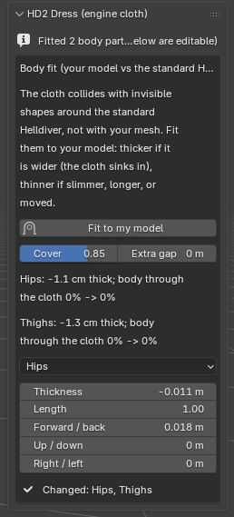

**Show colliders** (next to Fit to my model) draws the colliders over your model in the 3D view, with your Body fit
values applied: the body part picked in the list is **green**, the rest orange. It updates live while you move the
sliders, so you can see where your model sticks out past a collider (the cloth would sink in there) or where a
collider stands off the body (the cloth floats). It only draws in the viewport: nothing is added to your scene.

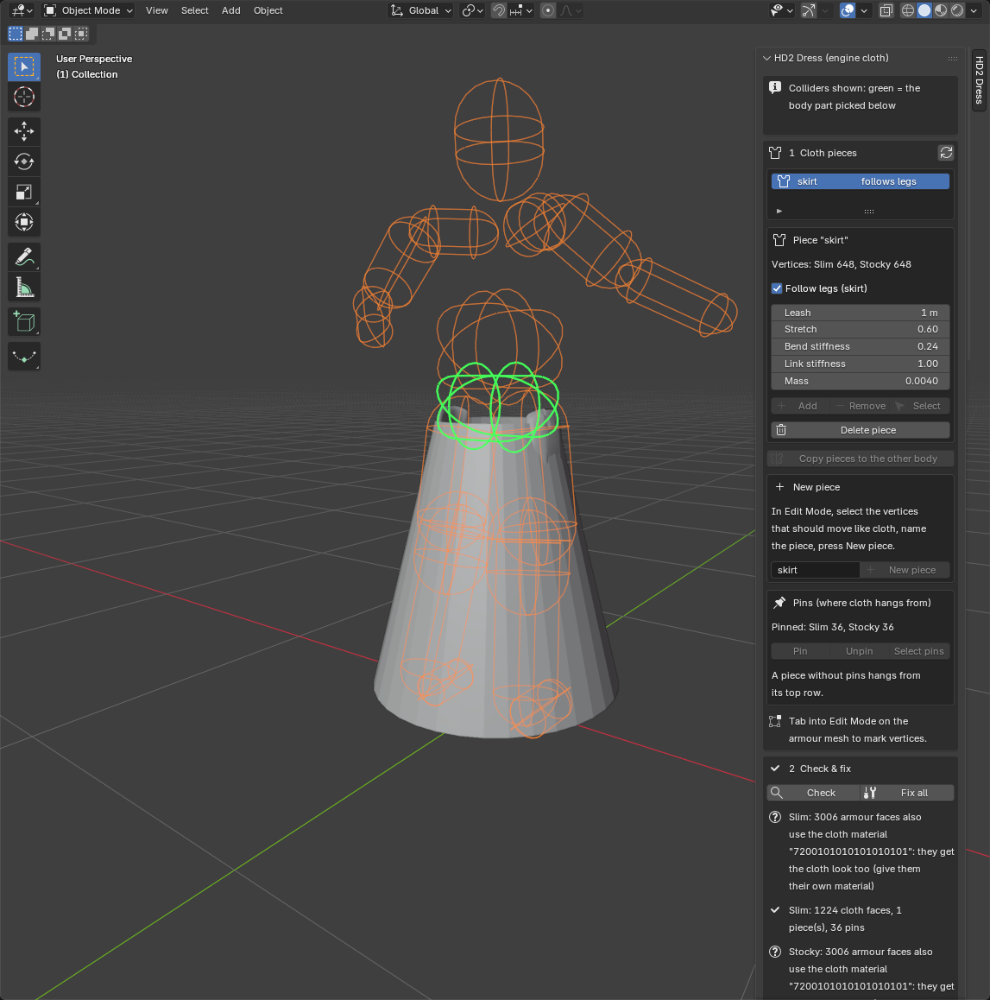

**Substeps are locked to 1**: above 1 the game draws garbage spikes on cloned divers (armory, hellpod), the stock capes
too.

### Step 6: look

**4 Look** builds the cloth's material from your pictures: a **colour map** (required), an optional **normal map** and
**AO map**, and **roughness** (one value, or an optional **roughness map**; white = matte). The maps may have different sizes. The folder buttons open next to your .blend.

**Keep my material** (the second choice in the list): if your cloth faces already use a finished HD2 material in your
armour patch (your own textures, normal map, values), the build keeps its textures and values and only turns on the
switch cloth needs. Use this when the colour-map look cannot match your material. Export that material with HD2SDK as usual.

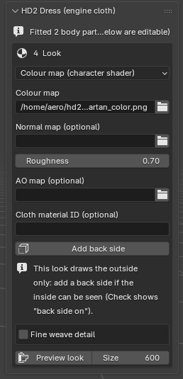

**Add back side**: this look draws the outside of the cloth only. If the inside can be seen (a half skirt from the
front, a cape from behind), press it once: it adds a reversed copy of the cloth faces that moves with the front.

**Preview look** renders front, side and back views in Blender (no game needed) and opens them in a window. It shows
how the texture sits on your UVs; it does not run the game's shader or the physics.

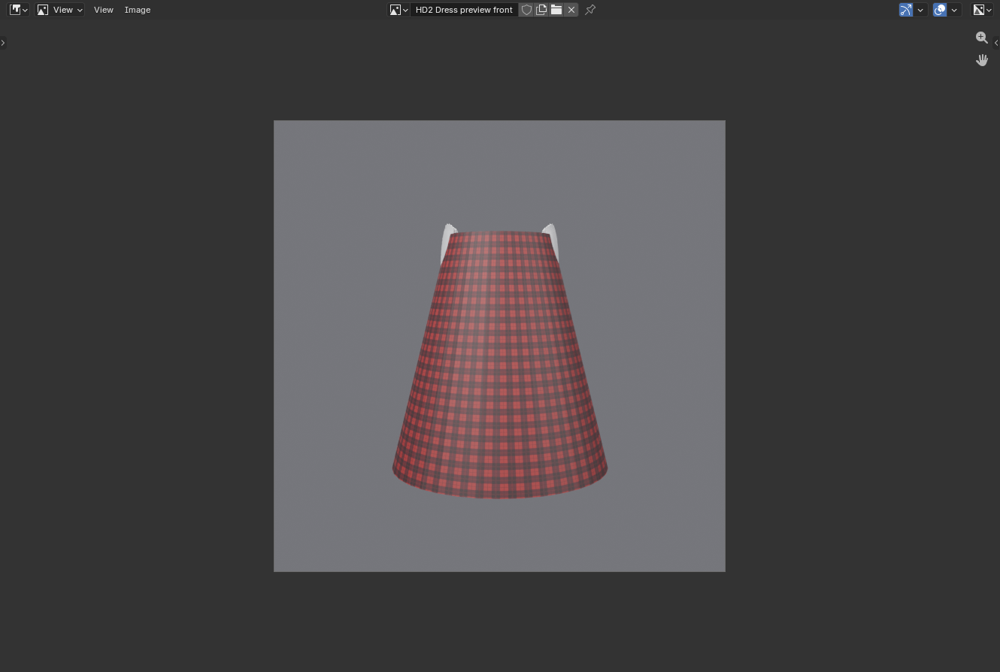

*Fine weave detail* adds a tiled detail normal. Keep it subtle: folded cloth can go dark, because the lighting of this
look does not follow the folds.

### Step 7: build

Fill in **Cloth name** (unique per mod: it is the cloth's name in the game) and choose the **Armour patch** you
exported with HD2SDK (the eyedropper takes the patch HD2SDK has open). Press **Build**. It runs in the background (your
Blender stays usable); the time and a Cancel button show under the button.

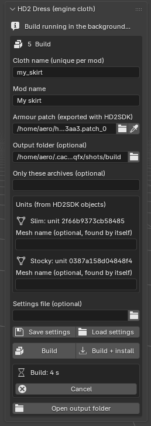

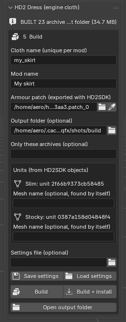

The output folder (`hd2dress_build/<cloth name>` next to your .blend, or the one you chose; **Open output folder**
shows it) holds:

- one `<archive>.patch_0` (+ `.gpu_resources`, `.stream`) for **every armour item that uses your armour unit** (B-01:
  23 items). The game reads the cloth from the archive of the armour the player has equipped, so all of them are
  needed;
- `9ba626afa44a3aa3.patch_0` = **your armour patch with the cloth material added** (made from the armour patch you
  chose). Ship this one instead of your original armour patch;
- `_debug/` with `manifest.txt` (which file is what), the settings used and the raw cloth: **not** for shipping.

**Build + install** also copies the patches into your own game folder for testing. It never overwrites a patch that is
not from HD2 Dress (another mod's patch_0 is left alone and the next free number is used).

**Save settings** writes everything to `<your blend>_cloth.toml` (Build does this too). **Load settings** brings it
back. Save your .blend as well: the settings file reads the pieces from the saved .blend.

---

## 4. Ship it

Your release = everything in the output folder except `_debug`: the
`9ba626afa44a3aa3.patch_0` the build wrote (your armour + the cloth material, replacing your original armour patch) and
one cloth patch per armour item. Keep the file names exactly as the build wrote them. Players install them like any
patch mod.

### Cloth on its own unit, and mod options (Arsenal)

The cloth can be its own armour unit (for example a skirt that players can switch on and off as a mod option): every
armour piece is a separate unit attached to the Helldiver, and engine cloth works per unit.

- Put the cloth pieces and pins on **the cloth's own object** (the one HD2SDK exports as that unit), not on another
  armour object. **5 Build > Units** shows which unit the cloth goes to. Run **Check** and **Fix all** on that object
  too: its skeleton needs the collision bones.
- The unit must be an existing game unit (engine cloth loads from a patch of the unit's own game archive). Armour mods
  reuse game units, so this is normally true; a brand-new unit id that only exists in your mod cannot get cloth.
- **Ship the cloth patches in the same option as the cloth mesh.** The "skirt on" option gets the skirt and every file
  from the build's output folder (except `_debug`); the option that hides or removes the skirt gets none of them.
  Never ship a cloth patch without its mesh: a cloth whose mesh is missing can freeze the game (seen in testing).

## 5. Test in game

Walk, sprint, dive, kneel, crouch, and the emotes **Thumb of Approval** (thumbs up), **Squat** and **Front-Leaning Rest Position** (push-ups) (the hardest tests for skirts). Check the armory
and the hellpod (cloned divers). Test both body types.

## 6. Known limits

- **No self-collision**: long loose cloth can fold through itself in extreme poses.
- **The lighting does not follow the folds** with the colour-map look; folds show by shape and shadow. Shading painted
  into the colour or normal map helps.
- **Substeps must stay 1** (game bug on cloned divers).
- The cape-shader look (lighting follows folds, zone colours or a full-cover decal) is not built by the panel yet; see
  `CLOTH_MATERIAL_RESEARCH.md`.

## 7. When something is wrong

| You see | Do this |
|---|---|
| *Helldivers 2 not found* | choose the game's `data` folder in the box under it |
| Check: *no whole faces in any cloth piece* | a piece needs complete faces: select whole faces, not single vertices |
| Build: *no material section of the mesh holds the cloth triangles* (older: *material "None"*) | the cloth is on a blank or unnamed material (often the one used to hide armour parts): give the cloth faces their own numbered HD2SDK material, export again |
| Check: *cloth faces use N materials* | give all cloth faces one material (the others would be invisible in game) |
| Check: *armour faces also use the cloth material* | give the armour faces their own material, or they get the cloth look |
| Check: *the cloth is only on Brawny: Slim and Stocky get no cloth* | fine if you only want it on that body; otherwise Copy pieces to the other body |
| Check: *closed shape* | cloth is a sheet: mark only the hanging part, not a closed shell |
| Build: *mesh name unknown* | type the mesh's node name under Units (game armour is found by itself) |
| Build: *textures were left uncompressed* | the mod works but is larger. Windows: install the Microsoft Visual C++ Redistributable (x64), which HD2SDK's texconv needs, and build again |
| Build FAILED | the message names the cause and the full log file (`.cache/hd2-dress/panel/<cloth name>/build.log` in your user folder). Send that file when you report a problem |
| Cloth invisible in game | cloth faces on another material than the main cloth material (see Check) |
| Check: *the cloth is two separate layers a few mm apart* | delete the inner layer (or remove the Solidify), then 4 Look > Add back side |
| Part of the cloth disappears from some angles | you are seeing its inside: 4 Look > Add back side. Also check no cloth faces sit on a second material |
| HD2SDK export: *Vertex Group: cloth_... is not a valid vertex group* | update HD2 Dress (0.6.11+), which keeps the cloth and pin groups out of HD2SDK's export. Keep HD2 Dress enabled while you export |
| The game crashes with the cloth installed | 4 Look must match your material: **Colour map** or **Keep my material** for normal armour materials; "My own cloth material" only for a cape-shader material (the build now stops if they do not match) |
| The cloth shows the wrong texture (patches of the body texture) | the cloth's mesh has more than one material: put the cloth on a unit of its own with one material (Check: *this mesh uses N materials*) |
| The cloth jitters, or single points fly out | the cloth starts inside the body colliders (Check: *free cloth points start inside the body colliders*). The build shrinks the worst colliders automatically; **Fit to my model** fits them to your body properly. Also check for a double layer |
| Garbage spikes in the armory | a lower LOD uses the cloth material |
| Build: *the unit keeps the mesh on a moved node* | 2 Check & fix → Fix all with the patch open in HD2SDK, export the patch again, build |
| The skirt sits inside your model's hips or buttocks | **Fit to my model** (3 Physics, Body fit), or by hand: Hips (and Thighs) thicker; also Leash smaller (e.g. 0.15) and Bend higher (e.g. 0.6) so it holds its modelled flare |
| A knee pokes through | Leash up (0.55+), Kneecaps on, Iterations 4 |

Command line, every setting and the research behind the values: `ENGINE_CLOTH_GUIDE.md`, `ENGINE_CLOTH_VALUES.md`.
